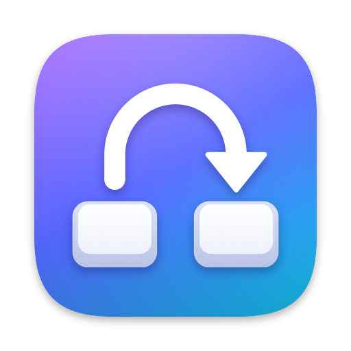
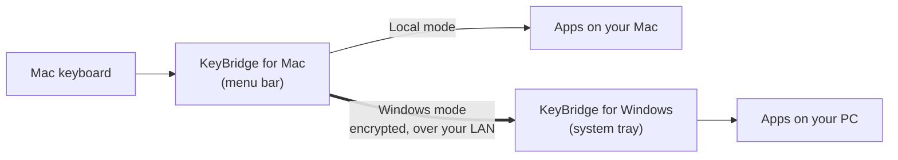

<p align="center">
  
</p>

<h1 align="center">KeyBridge</h1>

<p align="center">
  <strong>Use your Mac's keyboard to type on a Windows PC over your local network.</strong><br>
  A Mac menu-bar app captures your keys. Press <kbd>Ctrl</kbd> + <kbd>Shift</kbd> + <kbd>&#96;</kbd> and they go to a Windows tray app instead.<br>
  Native, tiny, encrypted.
</p>

<p align="center">
  <a href="https://github.com/cameronmaclaurin/KeyBridge/releases/latest"></a>
  <a href="https://github.com/cameronmaclaurin/KeyBridge/actions/workflows/ci.yml"></a>
  <a href="LICENSE"></a>
  
</p>

---

## Download

| | File | What it is |
|---|---|---|
| **Mac**<br><sub>macOS 13+, Apple Silicon & Intel</sub> | [**KeyBridge-macOS.pkg**](https://github.com/cameronmaclaurin/KeyBridge/releases/latest/download/KeyBridge-macOS.pkg) | Installer, **recommended**. Installs KeyBridge into Applications. |
| | [KeyBridge-macOS.dmg](https://github.com/cameronmaclaurin/KeyBridge/releases/latest/download/KeyBridge-macOS.dmg) | Disk image. Drag KeyBridge to Applications. |
| **Windows**<br><sub>Windows 10/11, 64-bit</sub> | [**KeyBridge-Windows-Setup.exe**](https://github.com/cameronmaclaurin/KeyBridge/releases/latest/download/KeyBridge-Windows-Setup.exe) | Installer, **recommended**. |
| | [KeyBridge-Windows-Portable.exe](https://github.com/cameronmaclaurin/KeyBridge/releases/latest/download/KeyBridge-Windows-Portable.exe) | A single exe. Nothing to install. |
| **Checksums** | [SHA256SUMS.txt](https://github.com/cameronmaclaurin/KeyBridge/releases/latest/download/SHA256SUMS.txt) | Check that your download is intact ([how](#verify-your-download)). |

You need both halves: the Mac app on the Mac whose keyboard you type on, and the Windows app on the PC. Older versions are on the [Releases](https://github.com/cameronmaclaurin/KeyBridge/releases) page.

## How it works



The Mac app listens on TCP port 9876 and the Windows app connects to it. In **Local mode** your keyboard works normally. Press the hotkey to switch to **Windows mode**: each key press and release is encrypted and sent to the PC, which types it. Press the hotkey again to switch back.

- **Keyboard only.** No mouse sharing. Both computers must be on the same local network.
- **Finds your Mac for you.** The Mac announces itself on your network with Bonjour, so the PC lists it by name. You can still type an address.
- **Native and small.** Swift/AppKit on the Mac (a ~300 KB universal app, under 20 MB of memory when measured). C/Win32 on Windows (one exe, no runtime).
- **Low latency.** `TCP_NODELAY` is on, and each key event is one 20-byte encrypted record. Most of the delay you feel comes from your network, so wired Ethernet or 5 GHz Wi-Fi works best.
- **Encrypted.** Each keystroke is encrypted and authenticated, and only a PC you've paired can connect. Pairing works like Bluetooth: you check that both screens show the same 6-digit number. See [Security](#security).

| On your Mac | On your PC |
|---|---|
| Menu-bar app with no Dock icon | System-tray app |
| Announces itself on your network (Bonjour) | Setup window that lists the Macs it finds, or takes the Mac's `Name.local` address or IP |
| Pairing window: compare a 6-digit number and click **Confirm** | The same 6-digit number to compare and **Confirm** |
| Launch at Login | Start with Windows |
| A warning when macOS Secure Input blocks key capture | Reconnects automatically |

## Install & set up

### 1. Mac

1. **Install.** Open **KeyBridge-macOS.pkg** and follow the installer. Or open **KeyBridge-macOS.dmg** and drag **KeyBridge** to **Applications**.
2. **Open KeyBridge** from Applications. The first time, macOS blocks it because the app isn't signed with a paid Apple certificate:
   open **System Settings → Privacy & Security**, scroll down, click **Open Anyway**, and confirm.
3. **Grant Accessibility.** KeyBridge needs it to read the keyboard. When macOS asks, open **System Settings → Privacy & Security → Accessibility** and turn on **KeyBridge**. If you missed the prompt, the KeyBridge menu has a **Grant Accessibility Permission…** item.

KeyBridge appears in the menu bar as a keyboard icon. It doesn't get a Dock icon. To start it automatically, choose **Launch at Login** in its menu.

### 2. Windows

1. Run **KeyBridge-Windows-Setup.exe**. If SmartScreen shows *"Windows protected your PC"*, click **More info → Run anyway**. The builds aren't signed with a paid Microsoft certificate yet.
   If you'd rather not install anything, run **KeyBridge-Windows-Portable.exe** from any folder.
2. KeyBridge starts in the system tray. It may be hidden under the **^** overflow arrow. If its setup window isn't open, open it from the tray icon.

### 3. Pair them (once)

Pairing works like pairing a Bluetooth keyboard: there's no code to type. If you're upgrading from KeyBridge 1.1, pair once more after updating both computers.

1. On the Mac, click the KeyBridge icon in the menu bar and choose **Pair a Windows PC…**. Keep this window open while you pair.
2. On the PC, open the KeyBridge setup window, pick your Mac from the list and click **Pair**. If your Mac isn't listed, type the address shown in the Mac's Pairing window instead (such as `Your-Mac.local` or `192.168.1.20`).
3. Both screens now show a 6-digit number, such as **482 913**. **Check that the two numbers are the same**, then click **Confirm** on the Mac and on the PC. If they're different, click **Cancel** ([why](#the-numbers-dont-match)).
4. Optional: turn on **Start with Windows**.

When the PC connects, the Windows tray icon turns from gray to color. That's it. Press <kbd>Ctrl</kbd> + <kbd>Shift</kbd> + <kbd>&#96;</kbd> on the Mac and start typing on the PC.

The Mac's Pairing window accepts a PC for 3 minutes. If that runs out, click **Start Again**. Pairing a new PC replaces the old one. To remove a pairing, choose **Forget This PC…** in the Mac's KeyBridge menu, or **Forget** on the PC.

## Using it

**Switching:** press <kbd>Ctrl</kbd> + <kbd>Shift</kbd> + <kbd>&#96;</kbd> on the Mac (that's Control, Shift and the backtick key, left of <kbd>1</kbd> on US keyboards). You can also choose **Switch to Windows Mode** or **Switch to Local Mode** from the KeyBridge menu. Keys you're holding down are released when you switch or when the connection drops, so nothing gets stuck. To use a different shortcut, open **Settings…** (<kbd>⌘</kbd> + <kbd>,</kbd> with the KeyBridge menu open) and click **Record Shortcut**.

**What the icons mean**

| Where | Icon | Meaning |
|---|---|---|
| Mac menu bar | Keyboard | **Local mode.** You're typing on the Mac. |
| Mac menu bar | Computer | **Windows mode.** You're typing on the PC. |
| Mac menu bar | Warning triangle | Windows mode, but macOS Secure Input is blocking capture, so keys stay on the Mac ([fix](#troubleshooting)). |
| Windows tray | Color | Connected to your Mac. |
| Windows tray | Gray | Not connected. KeyBridge keeps trying to reconnect. |

The KeyBridge menu on the Mac also shows the current mode, the connection status and the live round-trip latency to the PC (for example `PC connected: 192.168.1.20 · 3 ms`).

**Settings** (KeyBridge menu → **Settings…**): change the switch shortcut, swap <kbd>⌘</kbd> and <kbd>⌃</kbd> on Windows, play a sound when switching, turn notifications off, launch at login, and see or forget the paired PC.

**Key mapping**

| Mac key | Sent to Windows as |
|---|---|
| <kbd>Command ⌘</kbd> | <kbd>Windows</kbd> key |
| <kbd>Option ⌥</kbd> | <kbd>Alt</kbd> |
| <kbd>Control ⌃</kbd> | <kbd>Ctrl</kbd> |

For example, <kbd>⌘</kbd> opens the Start menu, and Windows shortcuts like <kbd>Ctrl</kbd> + <kbd>C</kbd> use the Mac's Control key.

Prefer Mac-style shortcuts? Turn on **Use ⌘ Command as Ctrl on Windows** in Settings. Then <kbd>⌘</kbd> + <kbd>C</kbd> / <kbd>⌘</kbd> + <kbd>V</kbd> copy and paste on the PC, and <kbd>⌃</kbd> Control becomes the Windows key.

## Security

- **Pairing with no secret to type.** The Mac and the PC agree on a new random key with an ECDH P-256 exchange, as Bluetooth does. After that, both sides prove they hold that key before any keystroke is sent. A device that isn't paired can't receive your typing or inject keys into your PC.
- **The 6-digit number stops eavesdroppers.** If another device on your network tried to get in the middle of pairing, the two screens would show different numbers. Each attempt has a 1 in 1,000,000 chance of matching by luck, and every attempt needs you to click Confirm on both computers. So do compare the numbers. They aren't secret, and you never type them.
- **Pairing only when you ask.** The Mac accepts a new PC only while its Pairing window is open, for up to 3 minutes. The PC pairs only when you click Pair.
- **Encryption.** Every keystroke is encrypted and authenticated with AES-256-GCM.
- **Forward secrecy.** Each connection uses fresh keys from another ECDH P-256 exchange, so recorded traffic stays secret even if the pairing key leaks later.
- **No stuck keys.** Held keys are released when you switch modes or the connection drops.

The full threat model is in [`SECURITY.md`](SECURITY.md) and the wire protocol in [`docs/PROTOCOL.md`](docs/PROTOCOL.md).

### Verify your download

Each release includes `SHA256SUMS.txt` and build-provenance attestations. In the folder where you saved your downloads, run:

```bash
shasum -a 256 -c SHA256SUMS.txt                                  # macOS / Linux
gh attestation verify <file> --repo cameronmaclaurin/KeyBridge   # needs the GitHub CLI
```

On Windows, `Get-FileHash .\KeyBridge-Windows-Setup.exe` in PowerShell prints the hash to compare with `SHA256SUMS.txt`.

## Troubleshooting

<details>
<summary><strong>The PC can't connect to the Mac</strong></summary>

- Check that both computers are on the **same local network**. Guest and public Wi-Fi networks often keep devices from talking to each other.
- **Firewall:** the PC connects to the Mac on **TCP port 9876**. If the macOS firewall is on, allow KeyBridge to accept incoming connections. On the PC, make sure security software isn't blocking KeyBridge.
- **Try the IP instead of `.local`.** Some networks don't resolve `Name.local`. Find the Mac's IP under **System Settings → Wi-Fi → Details… → TCP/IP** (or **Network → Ethernet → Details…**) and enter that in the Windows setup window.
- Make sure KeyBridge is running on the Mac. Look for its icon in the menu bar.

</details>

<details>
<summary><strong>My Mac isn't in the PC's list</strong></summary>

- Check that both computers are on the **same local network**, and that KeyBridge is running on the Mac.
- Open **Pair a Windows PC…** on the Mac and keep the window open while you pair.
- **Firewall:** the list uses Bonjour (multicast DNS, UDP port 5353), which some firewalls, security software and guest Wi-Fi networks block. If the macOS firewall is on, allow KeyBridge to accept incoming connections.
- **Type the address instead.** The list is only a shortcut. Type the Mac's name followed by `.local` (such as `Your-Mac.local`), or its IP address. The Mac's Pairing window shows both.

</details>

<details>
<summary><strong>"Not paired with this Mac — pair again"</strong></summary>

The Mac and the PC no longer share the same key. This happens if you clicked **Forget** on one of them, paired the Mac with a different PC, reinstalled, or upgraded from KeyBridge 1.1. [Pair them](#3-pair-them-once) again.

</details>

<a name="the-numbers-dont-match"></a>
<details>
<summary><strong>The numbers don't match</strong></summary>

Click **Cancel** on both computers. Nothing is saved. Different numbers mean the two computers didn't connect directly to each other: you may have picked the wrong Mac or PC, or another device on your network may be trying to interfere. Check that you chose the right Mac, then try again. If the numbers keep being different, don't confirm, and pair on a network you trust.

</details>

<details>
<summary><strong>"Pairing didn't complete"</strong></summary>

Someone clicked **Cancel**, the 3 minutes ran out, the Pairing window was closed, or the connection dropped. Nothing was saved. Click **Start Again** on the Mac and **Pair** on the PC.

</details>

<details>
<summary><strong>Keys aren't captured on the Mac</strong></summary>

KeyBridge needs **Accessibility** permission. Check **System Settings → Privacy & Security → Accessibility** and make sure **KeyBridge** is turned on.

**After updating:** these builds are unsigned, so macOS can treat a new version as a different app and keep the old permission. Select KeyBridge in the Accessibility list, remove it with **–**, then add it back with **+** (or reopen KeyBridge and grant permission again).

</details>

<details>
<summary><strong>Secure Input warning</strong></summary>

When a password field is focused, or an app such as Terminal has *Secure Keyboard Entry* on, macOS turns on Secure Input and no app can capture keystrokes. KeyBridge shows a warning, and your keys stay on the Mac. Click out of the password field or quit the app that's holding Secure Input.

</details>

<details>
<summary><strong>Windows says "Windows protected your PC"</strong></summary>

That's SmartScreen warning about an unsigned app. Click **More info → Run anyway**. To confirm the file is genuine first, [verify your download](#verify-your-download).

</details>

## Build from source

**Mac.** Requires Xcode Command Line Tools (`xcode-select --install`).

```bash
mac/build_app.sh    # build KeyBridge.app (universal)
mac/package.sh      # package it as the .pkg and .dmg
```

**Windows.** Run these from a *Developer Command Prompt for Visual Studio*. The installer step needs [Inno Setup](https://jrsoftware.org/isinfo.php) (`iscc`).

```bat
windows\build.bat 1.1.0
iscc /DAppVersion=1.1.0 windows\installer.iss
```

**Icons.** Every icon in [`assets/`](assets) is generated from code. To regenerate them, run `swift assets/src/make_icons.swift` from the repository root.

## FAQ

**Does it share the mouse too?**
Not yet. KeyBridge is keyboard only.

**Does it work over the internet?**
No. It only works on your local network, by design.

**Why do macOS and Windows show security warnings?**
The builds aren't signed with paid Apple or Microsoft certificates yet. The CI pipeline already supports signing, so it can be turned on once certificates are added. Until then, you can [verify your download](#verify-your-download) yourself.

**Which systems are supported?**
macOS 13 or later on Apple Silicon or Intel, and 64-bit Windows 10 or 11.

**What is `SHA256SUMS.txt`?**
An optional file for checking your downloads. It lists a fingerprint (SHA-256 hash) of every file in the release, so you can confirm that what you downloaded is exactly what was published. The release workflow generates it automatically. You don't need it to install KeyBridge. See [Verify your download](#verify-your-download).

## License

[MIT](LICENSE) © 2026 Cameron MacLaurin
